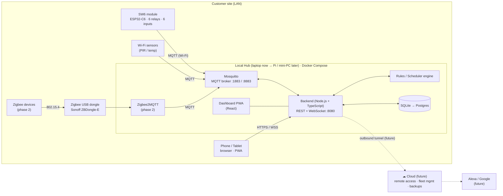
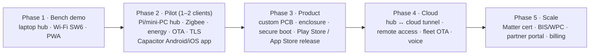

# 01 — System Architecture

> Product codename: **SW6** — 6-channel retrofit smart switch module, plus the local hub that runs everything.
> Strategy: **local-first** (works with zero internet), **cloud later** (same code, new deployment target).

---

## 1. Design principles (non-negotiable)

| # | Principle | What it means in practice |
|---|---|---|
| P1 | **Physical switch always works** | Wall switch toggles the relay directly in firmware, even if Wi-Fi, hub, or app is dead. |
| P2 | **Local-first** | Hub on the customer's LAN is the source of truth. Internet only adds remote access. |
| P3 | **State survives power cuts** | Device stores last relay states in NVS flash; restore policy per channel (last / off / on). |
| P4 | **Every command is acknowledged** | Commands carry a `cid` (correlation id). The UI shows ✓ only after the device confirms. |
| P5 | **Least privilege** | Each device has its own MQTT credentials and may only touch its own topic subtree. |
| P6 | **Multi-tenant from day 1** | Data model supports partner → site → room → device, even when only one site runs on a hub. |
| P7 | **Protocol-agnostic core** | Wi-Fi (native MQTT) and Zigbee (via Zigbee2MQTT) devices both map to the same `device` + `endpoint` model. |
| P8 | **Upgradable in the field** | Signed OTA with A/B partitions and automatic rollback. |

---

## 2. High-level architecture



---

## 3. Components

### 3.1 Edge device — SW6 module

| Item | Choice |
|---|---|
| MCU | ESP32-C6 (Wi-Fi 6 + BLE 5 + 802.15.4 Zigbee/Thread) |
| Firmware | ESP-IDF v5.x, C, FreeRTOS tasks |
| Channels | 6 × relay output (10 A @ 250 VAC), 6 × isolated mains-sense input (PC817) |
| Connectivity | Wi-Fi + MQTT (phase 1); Zigbee end-device / Matter-over-Thread (later, same chip) |
| Provisioning | BLE (ESP-IDF `wifi_provisioning` with security v2 / SRP6a) |
| Storage | NVS: Wi-Fi creds, MQTT creds, channel config, last states |
| Updates | OTA over HTTPS from hub, A/B partitions, rollback on boot failure |
| Safety | Hardware watchdog, brown-out detect, relays default OFF during boot |

**Firmware tasks:**

```
app_main
 ├── input_task      (50 Hz mains-pulse detection on 6 inputs, debounce, edge → toggle)
 ├── relay_ctrl      (single owner of relay GPIOs; queue-driven; persists state to NVS, rate-limited)
 ├── net_task        (Wi-Fi state machine, reconnect with backoff)
 ├── mqtt_task       (esp-mqtt client, LWT, subscribe cmd/ota, publish state/telemetry/event)
 ├── telemetry_task  (every 60 s: rssi, heap, uptime, temperature)
 └── ota_task        (download, verify sha256 + signature, switch partition)
```

### 3.2 Local hub

| Service (Docker) | Image / tech | Responsibility |
|---|---|---|
| `mosquitto` | eclipse-mosquitto:2 | MQTT broker; per-device auth via password file + ACL (later: dynamic security plugin) |
| `backend` | Node.js 22+ (24 LTS in dev) + TypeScript + Fastify | REST API, WebSocket push, MQTT adapter, device registry, rules engine, scheduler, OTA server |
| `db` | SQLite file (phase 1) → `postgres:16` | Relational data; Prisma ORM so the switch is a config change |
| `dashboard` | React + Vite + TypeScript PWA (served by backend as static); same code wrapped by Capacitor for Android/iOS | Control UI for owners, admin UI for installers |
| `zigbee2mqtt` | koenkk/zigbee2mqtt (compose profile `zigbee`) | Zigbee coordinator → MQTT |
| `simulator` | Node.js script (compose profile `dev`) | Fake SW6 devices for development without hardware |

**Backend internal modules:**

```
backend/src
 ├── auth/          phone + password login, passkeys (when hub has a real domain), JWT access + refresh tokens, RBAC guard
 ├── tenancy/       organizations, sites, floors, rooms, memberships, invitations
 ├── devices/       device registry, endpoints, claim/provisioning, credentials
 ├── mqtt/          broker client, topic router, payload validation (zod), adapters (native, z2m)
 ├── commands/      command queue, cid tracking, ack/timeout handling
 ├── state/         endpoint current state + history writer
 ├── automation/    triggers (state, time, sun, threshold), conditions, actions, scenes
 ├── ota/           firmware releases, OTA jobs, file server
 ├── realtime/      WebSocket gateway (per-site rooms)
 ├── audit/         event log
 └── notifications/ in-app (later: push, SMS, WhatsApp)
```

### 3.3 Clients

**Strategy: mobile-first, one codebase.** People control lights from a phone, not a laptop. One React + TypeScript app is built once and shipped as a web app, a mobile app (Capacitor) and, only if needed, a desktop app (Tauri).

| Client | Phase | Tech | Notes |
|---|---|---|---|
| Web app (PWA) | 1 | React + Vite + TS, Tailwind, TanStack Query, WebSocket | Phones, wall tablets, hotel front desk, office admin; installable from the browser |
| Installer console | 1 | Same app, role-gated screens | Claim devices, map channels to rooms, test |
| Android / iOS app | 2 (before first pilot) | Capacitor wrapping the same React code | Native BLE for device setup (iOS Safari has no Web Bluetooth), push notifications, biometric unlock, secure token storage |
| Desktop app | Only if needed | Tauri wrapping the same React code | Factory tool for bulk flashing and labelling devices |
| Voice (Alexa/Google) | Cloud phase | Cloud endpoint + account linking | Requires the cloud |

Capacitor plugins: `@capacitor-community/bluetooth-le` (provisioning), `@capacitor/push-notifications`, a biometric plugin (e.g. `@aparajita/capacitor-biometric-auth`), secure storage for tokens (Keychain / Android Keystore).

---

## 4. Network & ports (hub)

| Port | Protocol | Exposure | Purpose |
|---|---|---|---|
| 1883 | MQTT | LAN only, **dev only** | Plain MQTT for bench testing |
| 8883 | MQTT over TLS | LAN | Production device connections |
| 8080 | HTTP | LAN | API + dashboard (dev) |
| 443 | HTTPS / WSS | LAN | API + dashboard (production, self-signed or local CA) |
| 8081 | HTTP | localhost | Zigbee2MQTT frontend (admin only) |

Hub discovery on the LAN: mDNS `_sw6hub._tcp.local` → devices and the app find the hub without typing an IP.

---

## 5. Security model

| Layer | Control |
|---|---|
| Device identity | Unique ID = `sw6-<mac>`; per-device MQTT username/password generated at claim time (X.509 per device in production) |
| Transport | TLS 1.2+ on 8883/443 (hub-local CA), plain 1883 disabled outside dev |
| Broker ACL | Device may only publish/subscribe `ha/v1/{site}/dev/{itsOwnId}/#` |
| Users | Argon2id password hashes, short-lived JWT (15 min) + rotating refresh tokens |
| OS-level auth | Mobile app keeps the refresh token in Keychain / Keystore, unlocked by fingerprint / Face ID. Works fully offline on the LAN |
| Passkeys | WebAuthn (SimpleWebAuthn) via Windows Hello / Touch ID / Android. Needs HTTPS on a real domain, so it is enabled in the cloud phase, or earlier by giving each hub a domain such as `<hubid>.<ourdomain>.in` with a Let's Encrypt certificate (DNS-01) pointing at its LAN IP. Browsers reject passkeys on bare IPs and self-signed `.local` hosts |
| Phone OTP | SMS OTP fallback for login and recovery; needs internet + an SMS provider, so cloud phase |
| Authorization | RBAC: org role (platform_admin, partner_admin, technician) × site role (owner, admin, member, guest) |
| Firmware | Secure boot v2 + flash encryption (enabled before first client shipment, not on dev boards) |
| OTA | sha256 + ECDSA signature verified on device before switching partition |
| Audit | Every command / config change written to `audit_log` with actor + source |
| Privacy | Data stays on the hub by default (DPDP Act-friendly); cloud sync is opt-in per site |

---

## 6. Repository layout (to be scaffolded next round)

```
home_automations_project/
├── docs/                         ← you are here
├── firmware/
│   └── sw6-esp32c6/              ESP-IDF project
├── hub/
│   ├── docker-compose.yml
│   ├── mosquitto/                config, acl, passwords
│   ├── backend/                  Node.js + TS (Fastify, Prisma, zod, mqtt.js)
│   └── dashboard/                React + Vite PWA (+ Capacitor android/ and ios/ projects)
├── packages/
│   └── protocol/                 shared TS types + zod schemas for MQTT payloads
├── tools/
│   └── device-simulator/         fake SW6 devices
└── hardware/
    └── sw6/                      schematics (SVG now, KiCad later), BOM
```

---

## 7. Evolution path



Cloud phase design (summary): each hub runs a **cloud agent** that opens an *outbound* MQTT-over-TLS/WebSocket connection to the cloud (no port forwarding at the customer's router). The cloud mirrors device state, forwards remote commands down to the hub, and the hub still executes them locally. The same backend code is deployed in the cloud with Postgres; the hub keeps SQLite/Postgres as its local cache.
