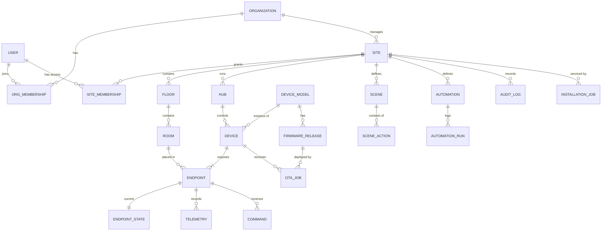
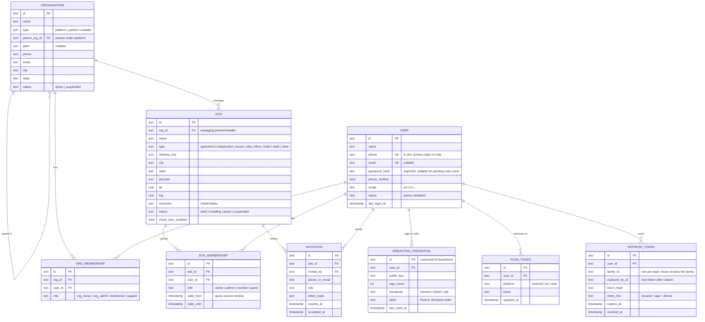
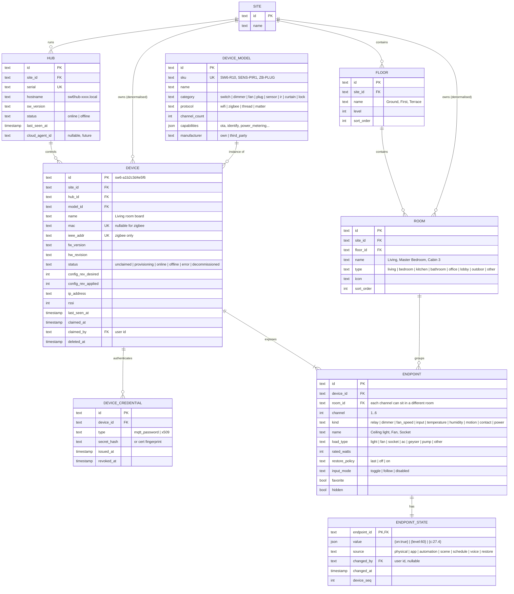
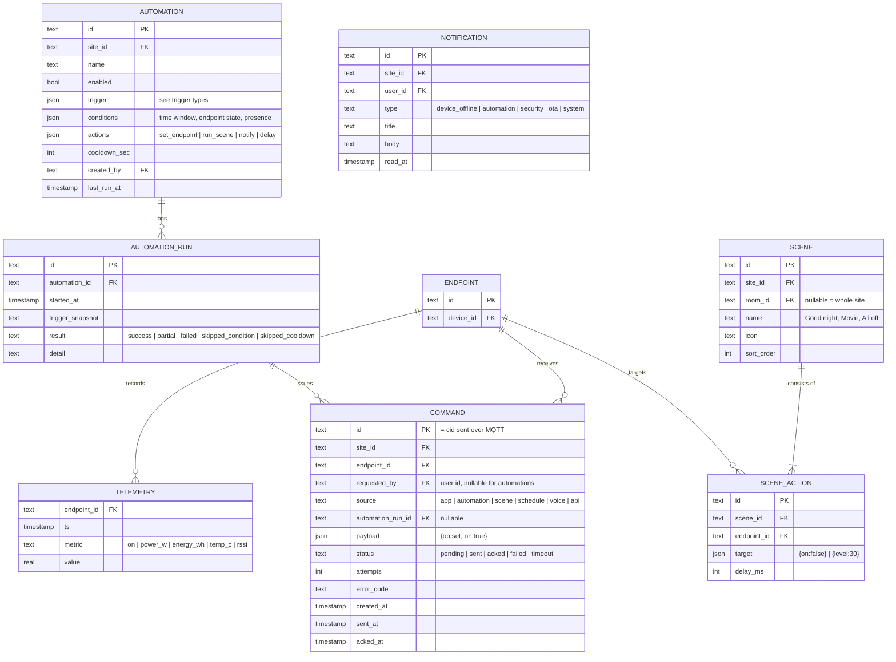
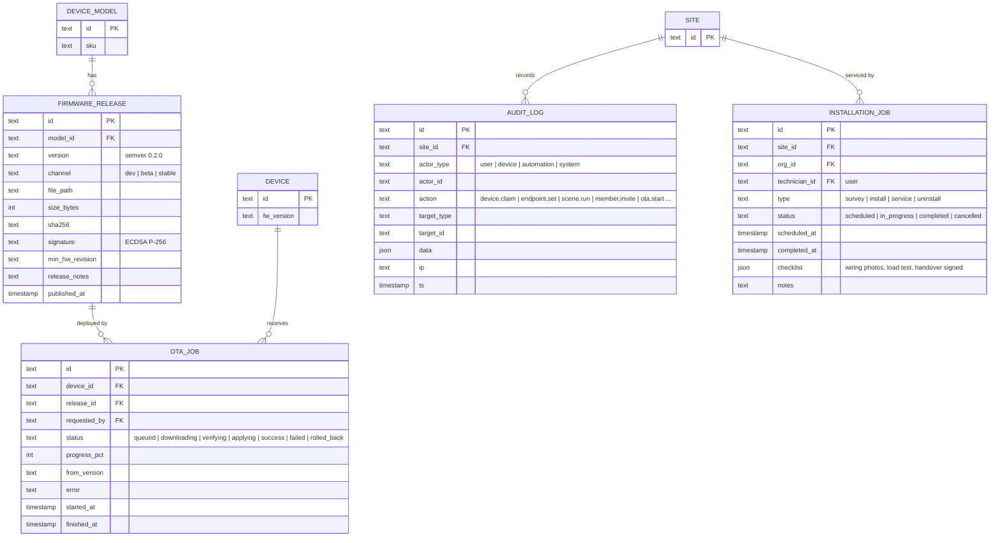

# 03 — Data Model (ER Diagrams)

Multi-tenant from day 1: **Organization (platform / partner / installer) → Site (home, villa, office, hotel…) → Floor → Room → Device → Endpoint (channel)**.

The same schema runs on the local hub (SQLite, usually one site) and in the future cloud (Postgres, all sites). Every site-scoped table carries `site_id`, so cloud sync is a plain filtered replication.

Conventions:
- Primary keys are **ULIDs** (`text`, sortable, generated offline on the hub; no collisions when syncing to the cloud).
- All tables have `created_at`, `updated_at` (omitted from diagrams for readability). Soft delete via `deleted_at` where noted.
- `json` = JSON column (SQLite `TEXT` with JSON functions, Postgres `JSONB`).
- Enum values are listed in §6.

---

## 1. Overview — all domains

---

## 2. Tenancy & identity

**Access rule:** a user can act on a site if they have a `SITE_MEMBERSHIP` on it **or** an `ORG_MEMBERSHIP` (technician+) on the organization that manages it. Hotel/office deployments reuse the same tables: a hotel = site, each guest room = room, staff = members, hotel guests = time-boxed `guest` memberships.

---

## 3. Topology & devices

**Why `ENDPOINT` matters:** a single SW6 board behind a switchboard often drives loads in two rooms (e.g. bedroom light + corridor light). Users think in *loads*, not *boards*, so the UI lists endpoints by room; the board is an installer-level detail.

---

## 4. Control, history & automation

**Trigger types (`AUTOMATION.trigger.type`):**

| type | config example |
|---|---|
| `endpoint_state` | `{ "endpoint_id": "…", "to": { "on": true } }` |
| `motion` | `{ "endpoint_id": "pir…", "detected": true }` |
| `time` | `{ "cron": "0 19 * * *" }` |
| `sun` | `{ "event": "sunset", "offset_min": -15 }` (uses site lat/lng) |
| `threshold` | `{ "endpoint_id": "temp…", "metric": "temp_c", "above": 30 }` |
| `device_status` | `{ "device_id": "…", "to": "offline", "for_sec": 300 }` |

`TELEMETRY` is append-only and high-volume: SQLite table with `(endpoint_id, ts)` index and 90-day retention on the hub; TimescaleDB hypertable in the cloud phase.

---

## 5. Operations: firmware, audit, field service

---

## 6. Enums (single source of truth)

| Enum | Values |
|---|---|
| `org_type` | platform, partner, installer |
| `org_role` | org_owner, org_admin, technician, support |
| `site_type` | apartment, independent_house, villa, office, hotel, retail, other |
| `site_role` | owner, admin, member, guest |
| `device_status` | unclaimed, provisioning, online, offline, error, decommissioned |
| `protocol` | wifi, zigbee, thread, matter |
| `endpoint_kind` | relay, dimmer, fan_speed, input, temperature, humidity, motion, contact, power |
| `load_type` | light, fan, socket, ac, geyser, pump, other |
| `change_source` | physical, app, automation, scene, schedule, voice, restore, api |
| `command_status` | pending, sent, acked, failed, timeout |
| `ota_status` | queued, downloading, verifying, applying, success, failed, rolled_back |

## 7. Role → permission matrix

| Action | guest | member | admin | owner | technician (org) | org_admin |
|---|:-:|:-:|:-:|:-:|:-:|:-:|
| Control endpoints | ✓ (allowed rooms) | ✓ | ✓ | ✓ | ✓ | ✓ |
| Run scenes | ✓ | ✓ | ✓ | ✓ | ✓ | ✓ |
| Create scenes / automations | | ✓ | ✓ | ✓ | ✓ | ✓ |
| Rename rooms / endpoints | | | ✓ | ✓ | ✓ | ✓ |
| Invite / remove members | | | ✓ | ✓ | | ✓ |
| Claim / remove devices | | | | ✓ | ✓ | ✓ |
| OTA updates | | | | ✓ | ✓ | ✓ |
| Transfer ownership / delete site | | | | ✓ | | ✓ |

## 8. Key indexes

| Table | Index |
|---|---|
| `site_membership` | unique (`site_id`, `user_id`) |
| `device` | unique (`mac`), unique (`ieee_addr`), (`site_id`, `status`) |
| `endpoint` | unique (`device_id`, `channel`, `kind`), (`room_id`) |
| `command` | (`endpoint_id`, `created_at` desc), (`status`) where status in (pending, sent) |
| `telemetry` | (`endpoint_id`, `ts`) |
| `audit_log` | (`site_id`, `ts` desc) |
