# 04 — Workflow Pipelines

Runtime flows (how the system behaves) first, then business and engineering pipelines (how you build, install and ship).

| # | Workflow | Type |
|---|---|---|
| W1 | Device lifecycle | State machine |
| W2 | Provisioning & claim (new SW6 joins a site) | Sequence |
| W3 | App command → relay (with ack) | Sequence |
| W4 | Physical switch → relay (local first) | Sequence |
| W5 | Automation engine | Flowchart |
| W6 | Offline, reconnect & state sync | Sequence |
| W7 | OTA firmware update with rollback | Sequence |
| W8 | Zigbee device join | Sequence |
| W9 | Power cut & boot | Flowchart |
| W10 | Customer journey: lead → install → support (B2C & B2B) | Flowchart |
| W11 | Installer on-site commissioning | Flowchart |
| W12 | Engineering pipeline: code → firmware release | Flowchart |
| W13 | Hardware pipeline: breadboard → certified product | Flowchart |
| W14 | Future cloud sync | Sequence |

---

## W1 — Device lifecycle

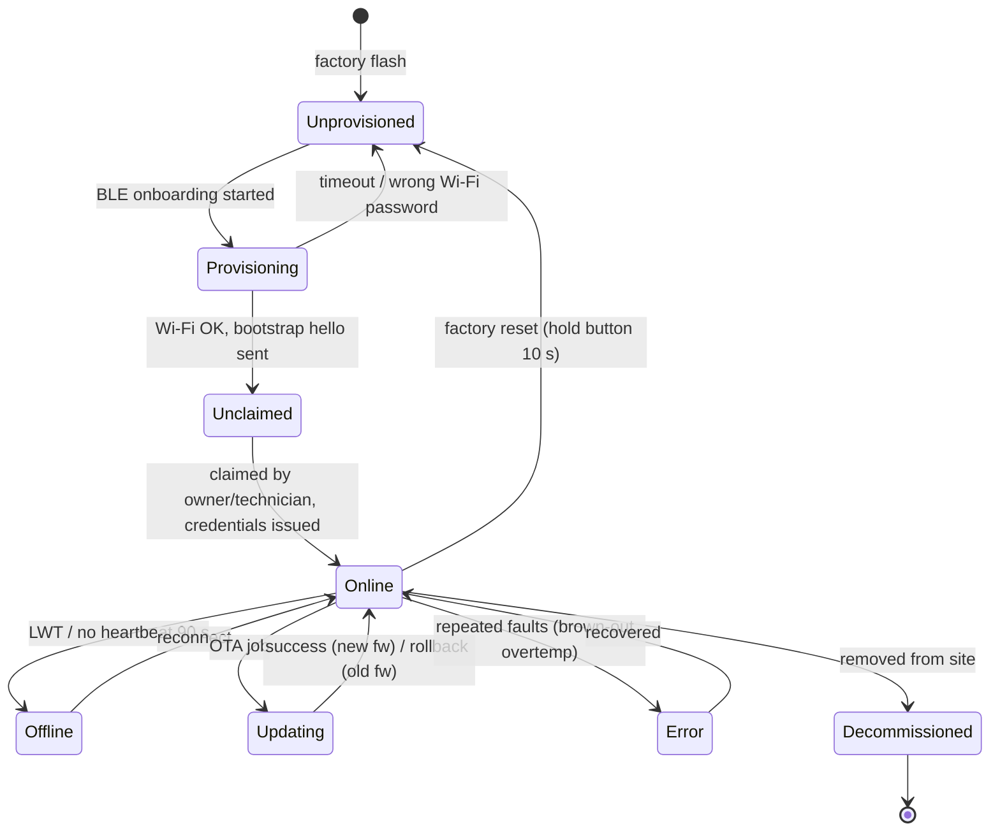

---

## W2 — Provisioning & claim

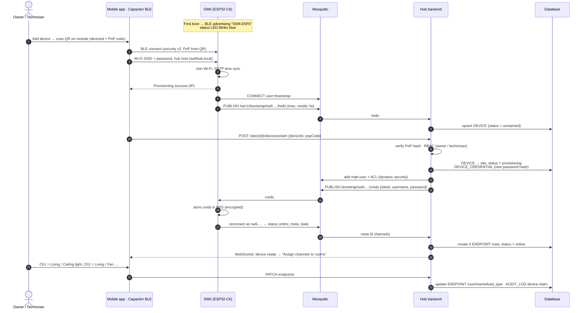

---

## W3 — App command → relay

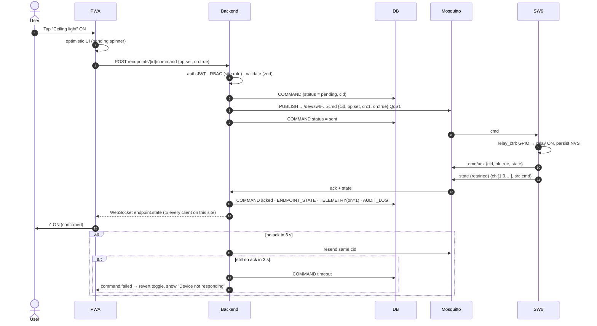

---

## W4 — Physical switch → relay (local first)

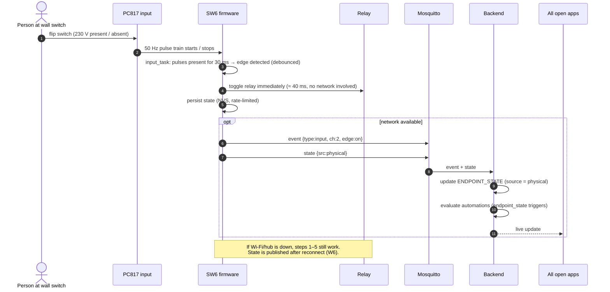

---

## W5 — Automation engine

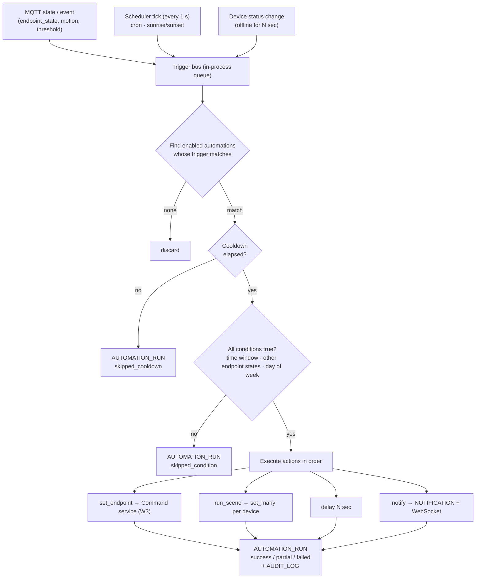

Example: *"After sunset, if motion in the corridor → corridor light ON for 3 min, unless it was already ON."*
`trigger = motion(pir-corridor)`, `conditions = [sun.after(sunset), endpoint(corridor-light).on == false]`, `actions = [set(on), delay(180), set(off)]`.

---

## W6 — Offline, reconnect & state sync

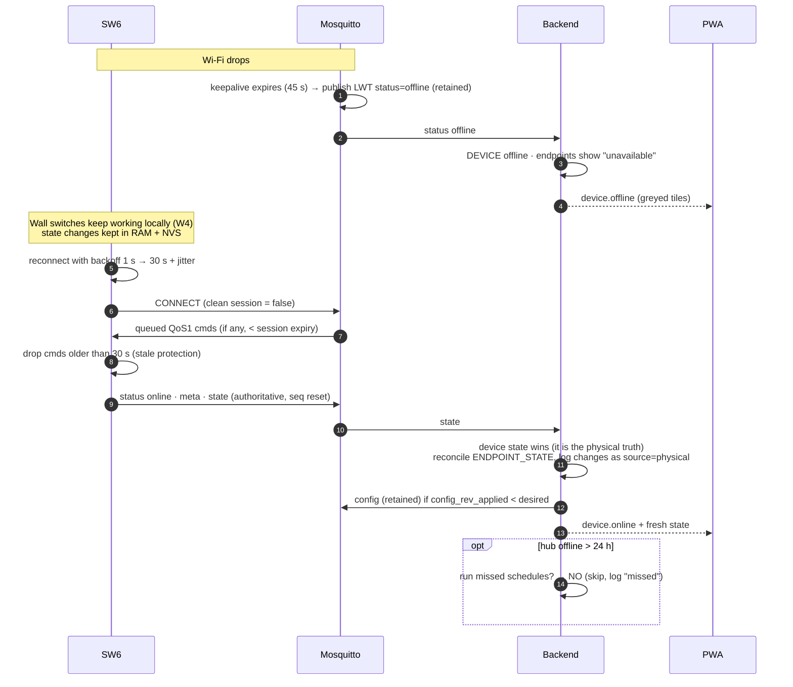

---

## W7 — OTA firmware update with rollback

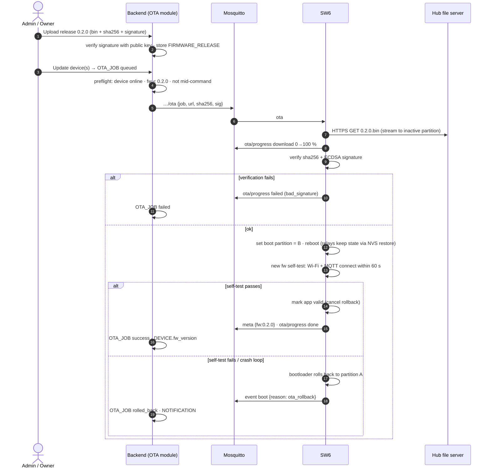

Rollout rule for pilots: update **1 device → wait 24 h → rest of the site**. In the cloud phase: staged rollout 1 % → 10 % → 100 % by `channel` (beta/stable).

---

## W8 — Zigbee device join (phase 2)

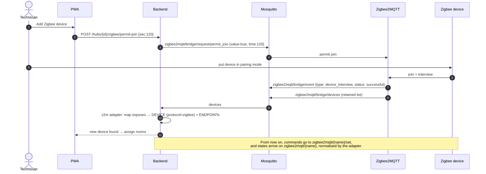

---

## W9 — Power cut & boot

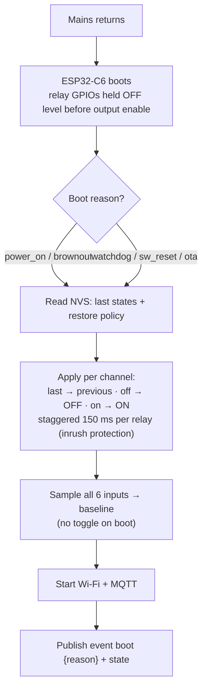

Staggering avoids switching six loads (LED drivers, fan) at the same instant, which would stress the HLK supply and the house MCB.

---

## W10 — Customer journey (B2C & B2B)

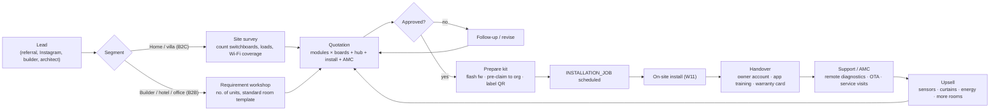

---

## W11 — Installer on-site commissioning

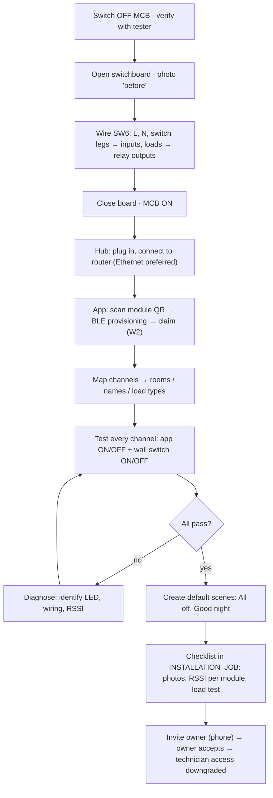

---

## W12 — Engineering pipeline (code → release)

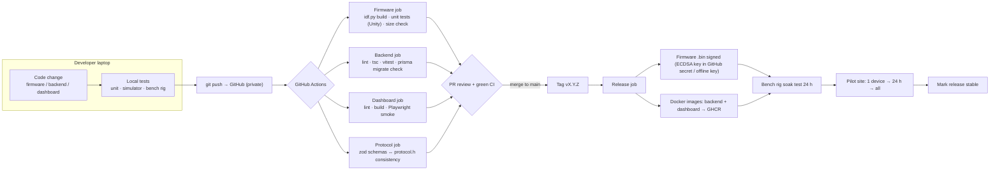

Branching: `main` (always deployable) + short-lived feature branches. Semver: firmware and hub are versioned independently; `packages/protocol` version bumps when the MQTT spec changes.

---

## W13 — Hardware pipeline (breadboard → certified product)

```mermaid
flowchart LR
  H1["Breadboard (low voltage)<br/>ESP32-C6 + relay module + buttons"] --> H2["Bench rig (mains)<br/>HLK supply, PC817 inputs, bulbs, MCB"]
  H2 --> H3["Perfboard prototype in ABS box<br/>first pilot client"]
  H3 --> H4["PCB v1 (KiCad → JLCPCB)<br/>creepage ≥ 6 mm mains↔LV, fuse, MOV"]
  H4 --> H5["Tests: thermal 6×8 A for 8 h · 10k switching cycles<br/>surge · Wi-Fi range · drop"]
  H5 --> H6["PCB v2 + V-0 enclosure<br/>(form factor fits behind Indian modular plates)"]
  H6 --> H7["Pre-compliance (EMI/safety) at a test lab"]
  H7 --> H8["Certification: BIS (if applicable) · WPC/ETA (radio) · Matter (optional)"]
  H8 --> H9["EMS manufacturing<br/>factory test jig · secure boot · per-device key injection"]
```

---

## W14 — Future cloud sync (design sketch)

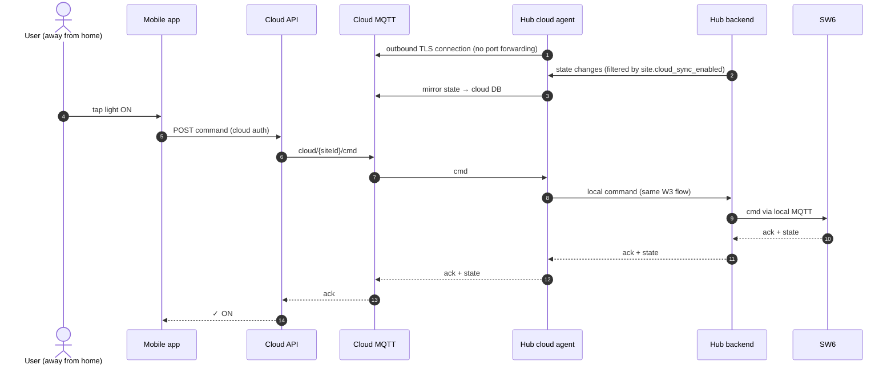
