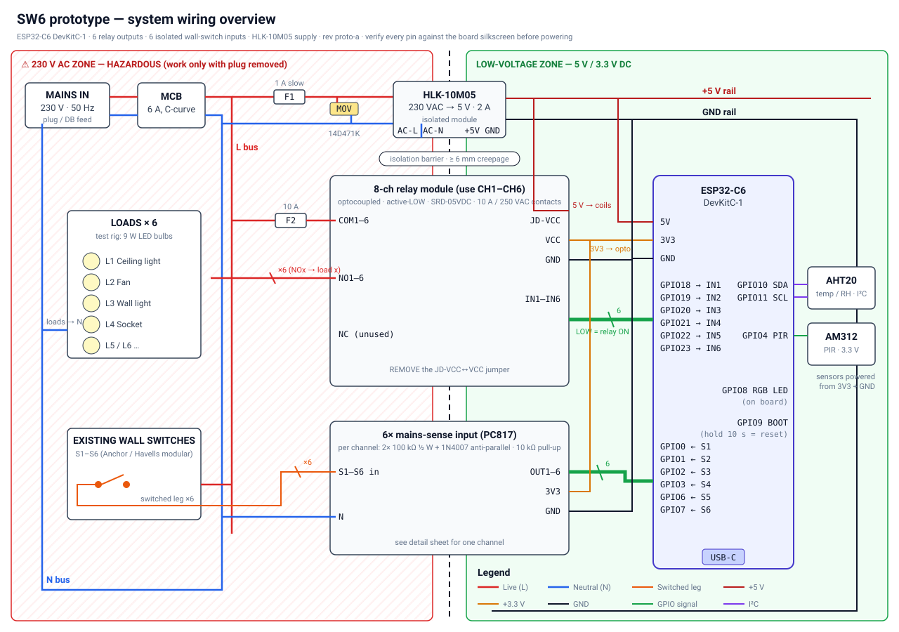
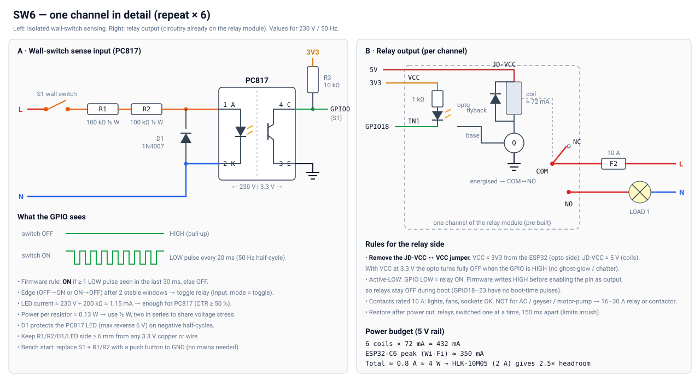

# 06 — Wiring & Build Guide (SW6 prototype)

Schematics (SVG, open in a browser or VS Code):

- System overview: [../hardware/sw6/sw6-wiring-overview.svg](../hardware/sw6/sw6-wiring-overview.svg)
- One channel in detail (input sense + relay output): [../hardware/sw6/sw6-channel-detail.svg](../hardware/sw6/sw6-channel-detail.svg)





---

## ⚠ Safety rules (read before touching mains)

1. Work on mains wiring **only with the plug pulled out** — never just "switched off".
2. Build and test everything on **USB power + push buttons first** (Stage 1–2). Mains comes last.
3. Every mains rig gets an **MCB + fuse**, and a closed box before it is powered.
4. Never touch the relay module's contact side or the PC817 input board while plugged in — their tracks carry 230 V.
5. Never leave a powered rig unattended during the prototype phase.
6. At a client site, the final electrical connection is done by a licensed electrician.

---

## Build stages

### Stage 1 — USB only, no relay (30 min)
- ESP32-C6 on breadboard, powered by USB-C from the laptop.
- 6 push buttons between GPIO 0, 1, 2, 3, 6, 7 and GND (internal pull-ups on).
- 6 LEDs + 330 Ω on GPIO 18–23 → 3V3 (active-LOW, same logic as the relay module).
- ✅ Pass: pressing a button toggles its LED; firmware logs over USB.

### Stage 2 — Relay module on low voltage (30 min)
- Remove the **JD-VCC jumper** from the relay module.
- Relay `VCC` → ESP32 `3V3`; relay `JD-VCC` → `5V` pin of the DevKit (USB 5 V, fine for testing ≤ 3 relays at once); `GND` → `GND`.
- `IN1–IN6` → GPIO 18–23.
- ✅ Pass: relays click on button press; no relay clicks during reset/boot.

### Stage 3 — Hub control (same day the hub software runs)
- Firmware connects to Wi-Fi + Mosquitto on the laptop.
- ✅ Pass: app toggles relays; button presses show up live in the app; unplug Wi-Fi router → buttons still work.

### Stage 4 — Mains power supply (plug pulled while wiring)
- Wire: plug → MCB → F1 (1 A) → HLK-10M05 AC input, MOV across L–N after F1.
- HLK `+5V` → ESP32 `5V` and relay `JD-VCC`; HLK `GND` → common GND. **Disconnect USB power** when HLK powers the board (or use a USB data-only cable for logs).
- ✅ Pass: measure 5.0–5.2 V at the HLK output with no load and with all 6 relays ON.

### Stage 5 — Mains loads (plug pulled while wiring)
- L bus → F2 (10 A) → COM1–COM6. NO1–NO6 → bulb holders → N bus.
- ✅ Pass: each bulb follows its relay from both the app and the button.

### Stage 6 — Real wall switches via PC817 (plug pulled while wiring)
- Build the 6-channel input board on perfboard exactly as in the channel detail sheet (R1 + R2 100 kΩ ½ W, D1 1N4007, PC817, R3 10 kΩ pull-up to 3V3).
- Keep ≥ 6 mm gap between the 230 V side and the 3.3 V side of the board (cut a slot in the perfboard between them).
- Wall switch legs → S1–S6 inputs; input board N → N bus.
- Firmware: switch input mode from "button" to "mains-pulse" (`input_mode` per channel).
- ✅ Pass: flipping a real modular switch toggles its bulb within ~50 ms; works with Wi-Fi off.

### Stage 7 — Box it
- Mount in the ABS box: mains side and LV side on opposite halves, cable glands / grommets, labels **"230 V"** on the lid.
- Mount box + bulbs + switches on the plywood test board → this is your client demo rig.

---

## Retrofit wiring at a real switchboard (for the pilot)

```
Before:                          After (SW6 behind the board):
L ──[switch]── load ── N         L ──┬──────────── COM (relay x)
                                     │             NO ─── load ── N
                                     └─[switch]─── S(x) input (PC817 board) ── N
```

The wall switch no longer carries the load current. It only signals the SW6, which drives the load through the relay. With `input_mode = toggle`, the switch position no longer matters: any flip toggles the load, so the app and the switch never fight each other.

Requirement: **neutral (N) must be available in the switchboard.** Most Indian switchboards have only L. Check during the site survey, and pull N from the distribution board if needed.
